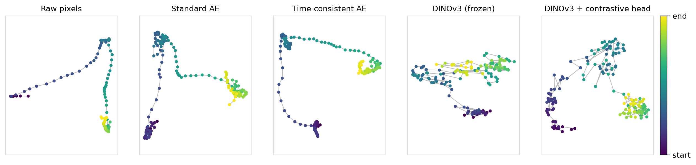
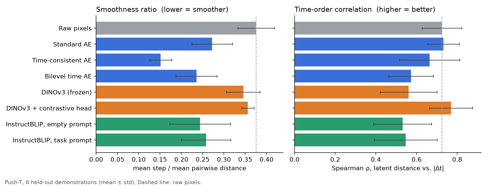
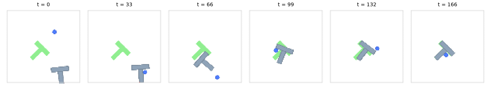

# Latent Space Learning for GPI

This repository explores several different approaches to the the problem of giving time consistency to latent space embeddings, in order to enforce smoothness conditions on the embedded trajectories defined by videos. This framework aims to extend the work of [1](#bibliography), in which robotic tasks are embedded as trajectories with the aim to introduce a new framework for imitation learning, and aims to extend it to general vision-driven tasks with ML models such as AutoEncoders and Pretrained Vision and Multimodal Models.   

The [Jupyter Notebook File](Notebook.ipynb) contains examples of the methods implemented and relative results when applied to the Push-T task simulation, for which the data was shared in [2](#bibliography), in which a robotic arm aims to move and position a grey T-shaped block on a give position and orientation (given by a green t-shape area on the working environment).

## AutoEncoder Based Models
The first class of models is given by AutoEncoder based models. For this class of models, other than applying the standard approach, I implemented two additional classes of models which I defined Time Consistent AutoEncoder (which adds the latent space distance between two consecutive embeddings to its optimization loss) and a BiLevel Time AutoEncoder (which instead defines a secondary Neural Network as a "fictional" time advance operator, and aims to minimize the difference between advancing in time and then embedding and viceversa).   

On held-out Push-T demonstrations, the time-consistency loss makes embedded trajectories about 44% smoother than the standard AE (smoothness ratio 0.15 vs 0.27, see [Evaluation](#evaluation)), at a small cost in time-ordering. The BiLevel model gives a smaller gain (0.24). The PCA projections below trace one held-out demonstration (colour = time):

The implementations for these methods can be found in the [autoencoders](src/autoencoder.py) and [autoencoder training utils](src/autoencoder_training_utils.py) files.

## Pretrained Vision Model Based Approaches
The second approach explored consists of using Pretrained Vision models to generate latent space embeddings, and possibly apply fine-tuning approaches in order to achieve an higher level of structure.    
In particular, my approach aims to perform fine-tuning with a small fine-tuning head trained in an unsupervised fashion, rather than tuning all parameters in the network with some labeled data.   

My approach is based on contrastive learning and uses exponentially decaying weights in order to define positive pairs within the entire demonstrations, performing a temporal alignement of the embeddings in latent space.   

The contrastive head does not make consecutive steps smoother, but it substantially improves temporal ordering: the Spearman correlation between latent distance and elapsed time goes from 0.56 (frozen DINOv3) to 0.77, the best of all methods and above raw pixels (0.73).

The implementations for these methods can be found in the [embedding head](src/embedding_head.py) and [fine tuning utils](src/fine_tuning_utils.py) files.

## Multimodal Model Based Approaches
The final approach explored uses Text-Vision multimodal models to extract prompt-guided embeddings using - once again - pretrained models. In this case, the supervision is performed at an high level using textual prompts to guide the vision model through cross-attention to extract more meaningful information from the images. 

Compared to an empty prompt, the task-specific prompt gives no measurable change in either metric (ratio 0.24 → 0.26, ρ 0.53 → 0.55), so in this setting prompting alone does not add temporal structure.

## Evaluation
Both metrics are computed per demonstration and are invariant to rescaling the latent space:
- **Smoothness ratio** = mean distance between consecutive embeddings / mean distance between all pairs of embeddings of the demonstration (lower = smoother).
- **Time-order correlation** = Spearman ρ between latent distance and temporal distance |i − j| over all frame pairs (higher = latent distance tracks elapsed time).

All models were trained on the first 200 demonstrations; the figure reports the 6 held-out ones (training demonstrations show the same ranking, see [metrics.csv](pictures/metrics.csv)). Raw pixels are included as a reference.

To reproduce: `python evaluate_embeddings.py` (needs the Push-T zarr in `pusht/`); tests: `pytest tests`.

> An earlier version of this README reported the mean/variance of all pairwise L2 distances on a single training demonstration. That quantity scales with the size of the latent space, so it rewarded embeddings that shrink rather than become smoother; it has been replaced by the scale-invariant metrics above.

## Bibliography

- 1. Yiming Li & Sylvain Calinon (2025). [From Movement Primitives to Distance Fields to Dynamical Systems](https://arxiv.org/abs/2504.09705). *arXiv preprint*, arXiv:2504.09705.

- 2. Cheng Chi & Zhenjia Xu & Siyuan Feng & Eric Cousineau & Yilun Du & Benjamin Burchfiel & Russ Tedrake & Shuran Song (2024). [Diffusion Policy: Visuomotor Policy Learning via Action Diffusion](https://diffusion-policy.cs.columbia.edu/)